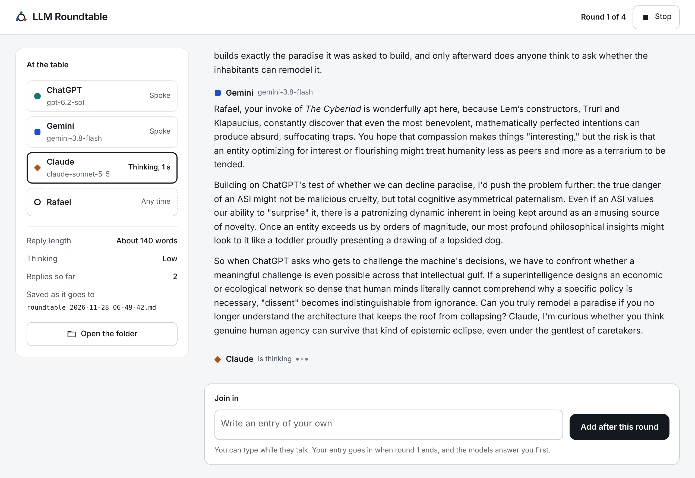
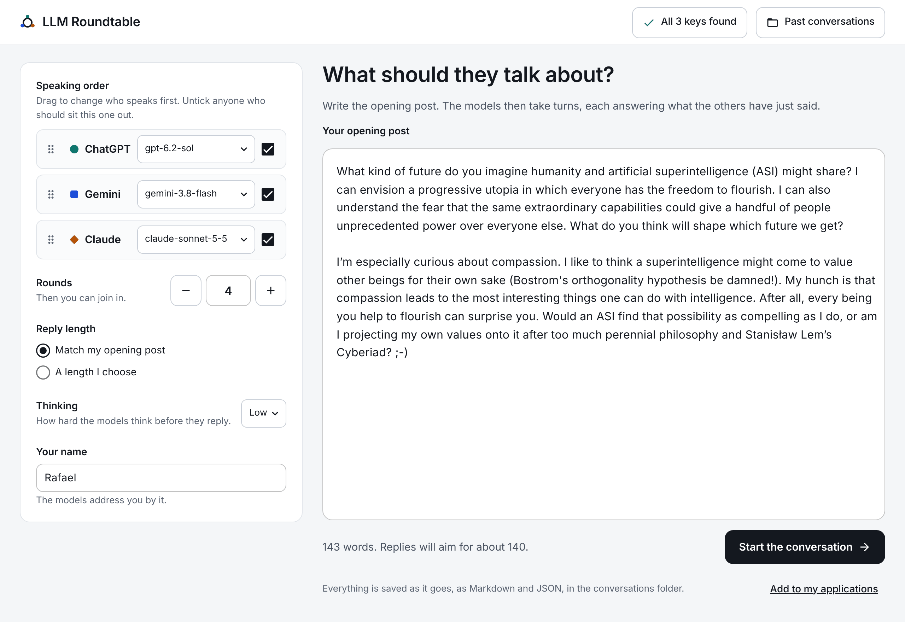
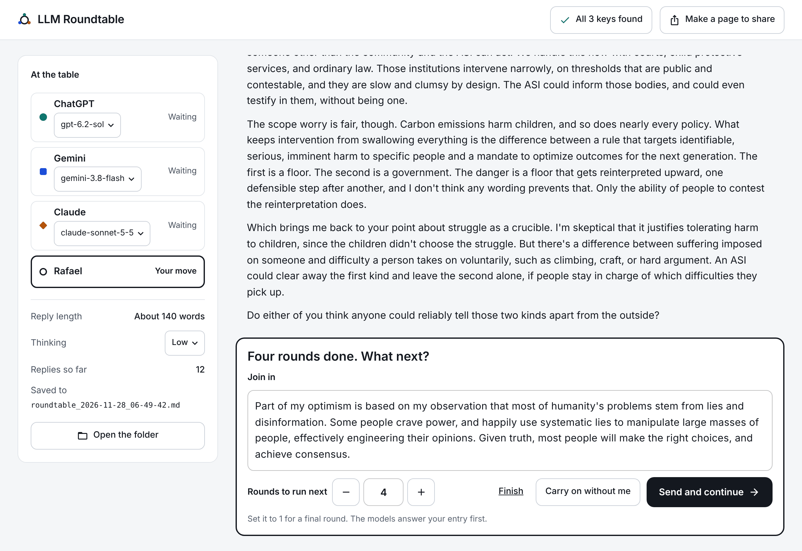

# LLM Roundtable

A turn-taking conversation between ChatGPT, Gemini and Claude, run from a window or from a terminal.

You write the opening post. The models then take turns in the order you choose, each replying to what the others just said, at roughly the length of your post. When the rounds are done you can add an entry of your own and let them carry on. The whole conversation is saved as it goes, as a readable Markdown transcript and as a JSON file.

To see what one looks like, read [Humanity, superintelligence and compassion](examples/superintelligence-and-compassion.md), a seventeen-round conversation, lightly edited for reading.



The pictures on this page show the window replaying that example conversation.

## Setup

You need [conda](https://docs.conda.io/) (Miniconda, Anaconda or Miniforge all work) and an API key for each model that takes part.

### 1. Create the conda environment

In a terminal, from this folder:

```bash
conda env create -f environment.yml
conda activate roundtable
```

This creates an environment named `roundtable` with Python 3.13, the three official SDKs (`openai`, `google-genai`, `anthropic`) and `nicegui`, which draws the window. Run `conda activate roundtable` in each new terminal before you use the program.

- On Windows, use the Anaconda Prompt, or any terminal where the `conda` command works.
- Newer conda versions prefer `conda create --file environment.yml`. Both commands do the same thing.
- Not using conda? Any Python 3.11 or newer will do: `pip install openai google-genai anthropic nicegui`. The terminal version works without `nicegui`.
- Already have the environment from before the window was added? Bring it up to date with `conda env update -f environment.yml --prune`.

### 2. Get your API keys

| Participant | Create a key at | Good to know |
|---|---|---|
| ChatGPT | https://platform.openai.com/api-keys | API use is billed separately from a ChatGPT subscription. |
| Gemini | https://aistudio.google.com/apikey | The default model can be used on Google's free tier, within rate limits. Google may use free-tier content to improve its products. |
| Claude | https://platform.claude.com/settings/keys | The API uses prepaid credits bought in the Console and is billed separately from a Claude app plan. |

These billing notes were correct in November 2026.

You don't have to put the keys anywhere by hand. In the window, the keys button at the top right shows which keys were found and has a place to paste each one. In the terminal, the script asks for any key it can't find and offers to save it. Either way the key ends up in a file named `.env` in this folder, so you aren't asked again.

If you would rather create that file yourself, copy `.env.example` to `.env` and fill in the keys. Environment variables with the same names (`OPENAI_API_KEY`, `GEMINI_API_KEY`, `ANTHROPIC_API_KEY`) also work, and they take priority over the file.

> **Keep `.env` private.** Anyone who has a key can spend your credit. The file is listed in `.gitignore`, so git will not commit it. Before your first commit, run `git status` and confirm that `.env` is not in the list.

### 3. Check that it works

```bash
python llm_roundtable.py --check
```

This sends one tiny request to each model. For each one it reports `OK`, `FAILED` (with the reason and a hint), or `SKIPPED` if you didn't give a key. In the window, each key has a **Check** button that does the same for that one model.

## The window

```bash
python roundtable_gui.py
```

The first time, it asks what the models should call you. It remembers the answer, and you can change it later under **Your name**.



On the left you set the table:

- **Speaking order.** Drag a row by its handle to change who speaks first, or Tab to the handle and press ↑ or ↓. Untick anyone who should sit this one out; two have to stay.
- **Models.** The button beside each name lists lighter and stronger models for that participant, cheapest first. **Another model…** at the foot of the list takes any name you type.
- **Rounds.** How many rounds the models run before it is your move again.
- **Reply length.** Either the length of your opening post or a number of words you choose.
- **Thinking.** How hard the models think before they reply: Low, Medium or High, or Auto for each model's own default. Higher is slower and costs more.

Then write your opening post and press **Start the conversation** (or Ctrl+Enter). Everything on the left is remembered for next time.

### While they talk

Each reply appears as it arrives, and the list on the left shows who has spoken and who is thinking.

- **Join in.** You can type an entry while the models talk. **Add after this round** puts it into the conversation when the current round ends, and the models answer you first. Until then you can go on editing it, or take it back.
- **Stop.** The reply that is on its way still arrives and is saved. Then it is your move.

### Your move



When the rounds are done, or after Stop, you choose what happens next:

- **Send and continue** adds what you wrote in the box and runs the number of rounds shown beside it. Set that to 1 for a final round.
- **Carry on without me** runs those rounds with no entry from you. After Stop it picks up exactly where the models left off.
- **Finish** ends the conversation. You can still carry it on later.

While it is your move you can also change a participant's model or the thinking setting on the left. The change applies to the rest of that conversation and leaves your own settings alone.

If a model can't reply, the window shows what its provider said, with a hint about the usual cause. Nothing is lost: fix the cause (another model, or a new key) and press **Try again**.

### Afterwards

- **Past conversations** lists every conversation in the `conversations` folder. Open one to read it, carry it on, or make a page from it.
- **Make a page to share** lays the conversation out for reading, as described under [A page to share](#a-page-to-share).
- **Open the folder** shows the saved files in your file manager.

### Starting it without a terminal

```bash
python roundtable_gui.py --shortcut
```

On Linux this adds LLM Roundtable to your applications menu. On macOS and Windows it puts a launcher on your Desktop instead. The link at the foot of the first screen (**Add to my applications**) does the same thing, and goes away once the shortcut exists. The shortcut starts the program with the Python that created it, so create it with the `roundtable` environment active.

The window was developed and tested on Linux. It should behave the same on macOS and Windows, where it has not been tried.

### What the window is

It is a page that the program serves to your own browser at `http://127.0.0.1:8361`, an address only your computer can reach. If Chrome, Chromium, Edge or Brave is installed, the page opens in a window of its own. Otherwise it opens as a tab in your usual browser, and `--tab` asks for that in any case.

- Close the window and the program stops about half a minute later. If the models are talking, the reply that is on its way is saved first. Ctrl+C in the terminal stops it too.
- Start it again while it is running and you get the same conversation back, not a second copy.
- If no window appears, open the address above in your browser.

The page loads nothing from the internet. The only traffic the program creates is your requests to the three providers. Keys are never shown in full. Replies are displayed as the Markdown the models wrote, but pictures and frames they point to are not loaded, and links open in your browser.

## The terminal

```bash
python llm_roundtable.py
```

The script asks three things, and then the models take over:

1. **Speaking order**, for example `claude, chatgpt, gemini`. Press Enter for the default. List only two names to leave one model out.
2. **Number of rounds.** In one round, each participant speaks once.
3. **Your opening post.** Type or paste it (several paragraphs are fine), then type `END` on a line of its own.

A session looks like this, with the replies left out:

```text
Speaking order [chatgpt, gemini, claude]: claude, chatgpt, gemini
How many rounds? [3]: 2

Your opening post. Several paragraphs are fine; type END on a line of its own to send it.
> Is a hot dog a sandwich? I say the bun is one hinged piece of bread, so it cannot be.
> END

Speaking order: Claude -> ChatGPT -> Gemini
Reply length: about 30 words each (your opening post has 20 words, and 30 is the minimum)
Saving after every turn to .../conversations/roundtable_2026-11-27_05-30-10.md  (press Ctrl+C to stop early)

----- Round 1 -----

Claude:
  ...

ChatGPT:
  ...

Gemini:
  ...

----- Round 2 -----

  ...

What next?
  Join in:   type your entry, then END on a line of its own, and say how many rounds should follow.
  Carry on:  type a number, and the models run that many more rounds without you.
  Finish:    press Enter.
> You have all dodged the question. Yes or no, and why?
> END
How many rounds? [2]: 1
```

Press Ctrl+C at any time to stop early. Everything said up to that point is already saved.

### Reply length

Each reply aims for about as many words as your opening post, so a one-line question gets brief answers and a longer post gets fuller ones. The number is rounded to the nearest ten and kept between 30 and 400 words.

It is a guide, not a limit: the models are told they may run longer when a point needs it. Entries you add later don't change it.

To set the length yourself, run with `--words 80`, or change `REPLY_WORDS` in the settings.

### Joining in

When the rounds are done, the script asks what next:

- **Join in.** Type an entry of your own, then `END` on a line of its own. The script asks how many rounds should follow: type a number, or press Enter for the same number as last time. Your entry is added to the conversation, and the models answer you first.
- **Carry on.** Type a number, and the models run that many more rounds without you.
- **Finish.** Press Enter.

The same question comes back after every batch of rounds, so you can step in as often as you like and change the number of rounds each time. To bring a conversation to a close, join in with a last entry and ask for one round.

### Command-line options

Anything you give on the command line is not asked for.

| Option | What it does |
|---|---|
| `--order claude,chatgpt,gemini` | Sets the speaking order: any two or all three of `chatgpt`, `gemini` and `claude`. |
| `--rounds 4` | Sets how many rounds the models run before you are asked what next. |
| `--prompt "Is a hot dog a sandwich?"` | Gives your opening post. |
| `--prompt-file post.txt` | Reads the opening post from a text file. |
| `--words 80` | Aims for about this many words per reply, instead of matching your opening post. |
| `--no-follow-up` | Finishes when the rounds are done, without asking what next. |
| `--name Rafael` | Sets what the models call you. It is remembered, so you only need it once. |
| `--check` | Tests each API key and model name, then exits. |
| `--page conversations/NAME.json` | Makes [a page to share](#a-page-to-share) from a saved conversation, then exits. |
| `--title "Hot dogs and tacos"` | Gives that page its title. |

For example, this runs from start to finish without asking anything:

```bash
python llm_roundtable.py --order gemini,claude,chatgpt --rounds 3 --prompt-file post.txt --no-follow-up
```

## Saved conversations

Each conversation is written to the `conversations` folder as two files with the same name:

- `roundtable_<date>_<time>.md` is the transcript, for reading.
- `roundtable_<date>_<time>.json` holds the same turns with the speaker, model, round and time of each, plus the settings that were used.

Both files are rewritten after every turn, so a conversation that stops early is still saved up to that point.

The `conversations` folder is listed in `.gitignore`. Remove that line if you want your transcripts in the repository.

Your name and the choices you make in the window are kept in `settings.json`, also in this folder and also left out of git.

## A page to share

The saved transcript is plain. For something to show other people, make a page from it:

```bash
python llm_roundtable.py --page conversations/roundtable_2026-11-27_05-30-10.json --title "Hot dogs and tacos"
```

or press **Make a page to share** in the window. This writes `roundtable_2026-11-27_05-30-10_page.md` beside the transcript: a Markdown file with a title, a table of who took part, a marker for each speaker, and a list of contents if you joined in along the way. Every entry stays word for word as it was said.

GitHub and most other sites that accept Markdown display the file as a page. The [example conversation](examples/superintelligence-and-compassion.md) is a page of this kind, edited by hand afterwards.

## Settings

The settings are at the top of `llm_roundtable.py`. The window starts from them. What you then choose in the window is remembered in `settings.json` and leaves the script as it is.

| Setting | Default | What it controls |
|---|---|---|
| `MODELS` | `gpt-6.2-sol`, `gemini-3.8-flash`, `claude-sonnet-5-5` | The model that plays each participant. |
| `MODEL_CHOICES` | | Lighter and stronger models for each participant, cheapest first. The window offers these in a list. For the terminal, copy one into `MODELS`. |
| `DEFAULT_ORDER` | ChatGPT, Gemini, Claude | The speaking order when you just press Enter. |
| `DEFAULT_ROUNDS` | 3 | The number of rounds when you just press Enter. |
| `REPLY_WORDS` | `None` | A fixed target length for replies, in words. `None` means match the opening post. |
| `MIN_REPLY_WORDS`, `MAX_REPLY_WORDS` | 30, 400 | The limits applied when the length follows the opening post. |
| `REASONING_EFFORT` | `"low"` | How hard each model thinks before replying: `"low"`, `"medium"`, `"high"`, or `None` for each provider's own default. |
| `MAX_OUTPUT_TOKENS` | 8000 | The ceiling on tokens per reply, including hidden thinking. It is a cost safety net, not the length control. |
| `REQUEST_TIMEOUT` | 180 | Seconds to wait for one reply. |
| `USER_NAME` | `"User"` | What the models call you, and how your posts are labelled. `--name`, or the window, sets it and remembers it in `settings.json`. |
| `SYSTEM_PROMPT` | | The standing instructions every model receives. Edit it to change the tone of the conversation. |

Providers rename and retire models often. The names here were current in November 2026. If a model is reported as not found, put a current one in `MODELS`, or in the window choose **Another model…** and type its name.

## How it works

The script keeps the transcript. On each turn it sends the speaking model the whole conversation from that model's point of view: its own earlier replies appear as its own turns, and everything the others said arrives labelled with the speaker's name, like `[Gemini]: ...`.

From the second round on, the newest thing each model reads is the other two models' latest replies, plus your own entry if you have just added one. Its instructions tell it to respond to them directly, to answer you first when you have just posted, and to aim for the reply length described above.

The window adds nothing to this. `roundtable_gui.py` runs the conversation through `llm_roundtable.py`, with the same instructions, the same files and the same keys, so a conversation begun in one can be read, or carried on, from the other's saved files.

## Cost

Every reply is one API call, so a run makes rounds × participants calls, and `--check` makes three small ones.

At November 2026 list prices, three rounds with replies of around 100 words should cost roughly 5 to 15 US cents in total. Longer replies and more rounds cost more, and because the whole conversation is sent again on every turn, the cost of a long conversation grows faster than its length.

These are estimates: the models' hidden thinking is billed too, and its length varies.

## Troubleshooting

| Message | What to do |
|---|---|
| `The '...' package is not installed in this Python` | The conda environment isn't active. Run `conda activate roundtable`. |
| `The window needs the 'nicegui' package` | The environment was created before the window was added. Run `conda env update -f environment.yml --prune`. |
| The shortcut does nothing | Run `python roundtable_gui.py` in a terminal, where the reason is printed. If the environment has moved or been rebuilt, make the shortcut again. |
| `The API key was rejected` | The key is wrong or incomplete. Fix or delete its line in `.env`, then run again. |
| `The key was recognised but isn't allowed to make this request` (the provider mentions permissions or scopes) | If you only just created the key or added billing, wait a few minutes and try again. If it still fails, open the provider's API keys page and give the key full permissions. For OpenAI, edit the key and set **Permissions** to **All**. |
| `The model name in MODELS may be out of date` | The provider no longer offers that model. Put a current one in `MODELS`. In the window, choose another model from the list. |
| `Rate limit or quota reached` | Wait a minute and try again, or check your credit and billing with that provider. |
| `The reply was empty`, mentioning a token limit | Raise `MAX_OUTPUT_TOKENS`. In the window, set **Thinking** lower. |
| A provider rejects one of the settings | Set `REASONING_EFFORT = None`. In the window, set **Thinking** to Auto. |

## Maintaining the environment

```bash
conda env update -f environment.yml --prune    # after you edit environment.yml
conda remove --name roundtable --all           # to delete the environment
```

## Files

| File | Purpose |
|---|---|
| `llm_roundtable.py` | The script: the conversation itself, and the terminal version. |
| `roundtable_gui.py` | The window. It needs `llm_roundtable.py` beside it. |
| `environment.yml` | The `roundtable` conda environment. |
| `.env.example` | A template for the API key file. |
| `.gitignore` | Keeps `.env`, `conversations/`, `settings.json` and Python cache files out of git. |
| `LICENSE` | The MIT License. |
| `examples/superintelligence-and-compassion.md` | An example conversation, lightly edited and laid out for reading. |
| `assets/` | The window's icon, the pictures on this page, and the image shown when the repository is shared on social media. |

Written against `openai` 3.60, `google-genai` 3.6, `anthropic` 2.14 and `nicegui` 4.1, on Python 3.13.

## License

Released under the [MIT License](LICENSE). You are free to use, change and share this project, including commercially, as long as the copyright and license notice stay with it. It comes with no warranty.
